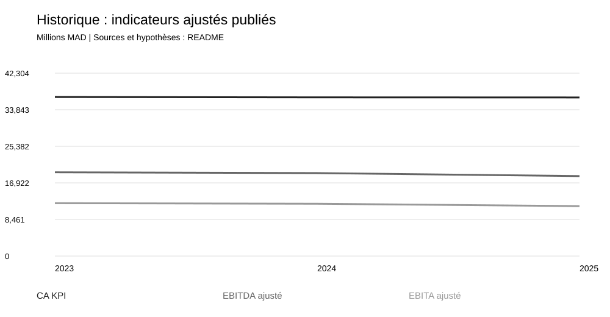

# Maroc Telecom — Finance, audit des données & analytics
Analyse 2023-2025 | Scénarios 2026-2030 | Python · SQL · Power BI

## Ouvrir les tableaux directement — aucun code nécessaire

**Commencer par [COMMENCER_ICI.html](COMMENCER_ICI.html)** après extraction du ZIP. Pour le notebook, utiliser [la version HTML avec résultats](notebooks/financial_analysis.html) si Jupyter n’est pas installé. Le `.ipynb` exige les dépendances de `requirements-notebook.txt`; celles-ci sont distinctes du pipeline Python sans dépendance. Le [guide d’ouverture](COMMENT_OUVRIR_LES_FICHIERS.md) explique chaque format et les erreurs fréquentes.

**[Rapport court en français (PDF, 5 pages)](reports/Rapport_Court_Maroc_Telecom.pdf)** : états de synthèse résumés, 19 ratios avec formules et explications, et conclusion. Présentation sobre en noir, blanc et gris. Pour le régénérer : installer `requirements-report.txt`, puis lancer `python scripts/build_short_report.py` après le pipeline.

1. **[Bilans, CPC, ESG, CAF, tableau de financement et 19 ratios](LIRE_LES_TABLEAUX.html)** : ouvrir ce fichier dans un navigateur. Tous les tableaux sont visibles sur la même page.
2. **[Classeur Excel](workbook/Maroc_Telecom_Etats_Sociaux.xlsx)** : 10 onglets, formules calculées, ratios nommés et expliqués, graphiques natifs.
3. **[Dashboard interactif](dashboards/dashboard.html)** : graphiques, tableaux et scénarios.

Les états de synthèse ci-dessus sont ceux d’**IAM SA seule (CGNC)**, publiés dans le DEU 2025, pages 233–238. Les comptes consolidés du **Groupe (IFRS/KPI)** et le DCF restent dans des tables séparées. L’ETIC complet est accessible dans le document officiel, pages 239–255; il n’est pas intégralement reproduit.

Les fichiers `data/tables/` donnent les postes en français et les années en colonnes. Les noms techniques dans `data/raw/` servent uniquement à la reproduction des calculs. Lire [l’organisation des données](docs/lire_les_donnees.md) pour les unités et les périmètres.

**Power BI :** projet éditable généré dans `dashboards/powerbi/IAM.pbip`, avec cinq pages sociales. Les fichiers ont été contrôlés contre les schémas PBIR Microsoft; le chargement et l’affichage dans Desktop n’ont pas été validés. Ce dossier n’est pas un PBIX final vérifié. Les tables incorporées sont des instantanés; régénérer le projet après modification des CSV via `python scripts/build_powerbi.py`.

Projet de portfolio en français : diagnostic financier consolidé, traçabilité documentaire, scénarios et DCF pédagogique. Données consultées le 7 novembre 2026. Les prévisions sont construites uniquement sur base FY2025 : aucune donnée 2026 ne les alimente. Le projet n'est ni affilié à Maroc Telecom ni une recommandation d'investissement.



## Démarrage (Python 3.10 ou supérieur)
Depuis le dossier racine décompressé :
```sh
python -m venv .venv
# Windows PowerShell
.venv\Scripts\Activate.ps1
# macOS / Linux : source .venv/bin/activate
python -m pip install -r requirements.txt
python -m src.pipeline
python -m unittest discover -s tests -v
python scripts/validate_notebook.py
```
Le pipeline utilise uniquement la bibliothèque standard : pas de dépendance externe, réseau, clé API ou téléchargement requis. Le fichier requirements.txt est volontairement sans paquet obligatoire. Si PowerShell bloque l'activation, utiliser directement .venv\Scripts\python.exe à la place de python. Tous les chemins sont résolus par rapport au dépôt.

## Livrables
- `data/raw/` : chiffres publiés uniquement, statut, base, source et page par observation; registre des URL.
- `config/scenarios.csv` : hypothèses modifiables des trois scénarios.
- `src/model.py` : ratios, prévisions et DCF; `src/pipeline.py` : production des sorties.
- `notebooks/financial_analysis.ipynb` : analyse reproductible sans dépendance de calcul externe.
- `data/processed/` : ratios, projections, DCF, sensibilité et base SQLite générés.
- `charts/` : trois graphiques SVG générés; `reports/financial_report.html` : rapport ouvrable dans un navigateur, avec graphiques; version Markdown également fournie.
- `sql/` : schéma et requêtes SQLite exécutées par le pipeline.
- `dashboards/` : CSV long Power BI et instructions avec DAX.
- `tests/` : contrôles de traçabilité, bilan, formules et sensibilité.
- `docs/` : dictionnaire, écarts documentaires, méthode et limites.

## Lire correctement les résultats
`reported` signifie publié par une source, pas certifié par ce projet; les KPI ajustés sont distincts des états IFRS. `calculated` désigne un calcul historique. `assumption` et `forecast` désignent des hypothèses et projections. Aucun chiffre manquant n'est inventé.
Les états IFRS et les tableaux KPI présentent certains écarts, notamment le CA 2024. Les deux bases restent visibles; lire [le dictionnaire](docs/data_dictionary.md). Les prévisions reposent sur des hypothèses explicites et non sur des engagements de la direction. La valorisation s'arrête à la valeur d'entreprise, faute d'un pont fiable vers les capitaux propres de la société mère.

## Sources principales
- [Maroc Telecom — chiffres clés](https://www.iam.ma/en/groupe-maroc-telecom/chiffre-cl%C3%A9s) : série des KPI ajustés 2023-2025.
- Rapport financier 2025 et communiqué FY2025 : liens complets et pages dans [sources.csv](data/raw/sources.csv).
Transcription manuelle de données vérifiées; aucun PDF officiel redistribué. Les droits des publications et marques restent à leurs titulaires.

## Dépôt GitHub

Dépôt public : https://github.com/Ahmedpoxt111/maroc-telecom-financial-analytics

Le code et la documentation sont sous MIT; les publications tierces conservent leurs droits. Voir le README anglais pour la validation de cette publication.

## Présenter le projet en entretien
Expliquer un écart de source, un contrôle bilan, la distinction EBITDA/FCFF, les hypothèses du DCF et la sensibilité au WACC. Ne pas prétendre avoir réalisé un audit légal ou prévu les résultats réels. Pour aller plus loin : segmenter Maroc/Moov Africa, analyser les échéances de dette, réconcilier IFRS16 et intégrer les publications suivantes avec versionnement.

Darija : الأرقام المنشورة مفصولة على الحسابات والفرضيات. بدّل الفرضيات وشغّل الكود باش تشوف التأثير، وما تقدّمش التوقعات بحال إلا كانت نتائج حقيقية.
