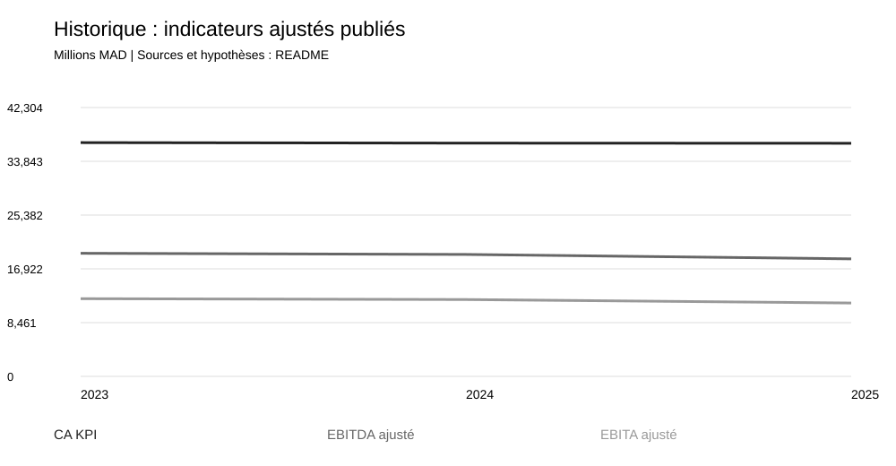
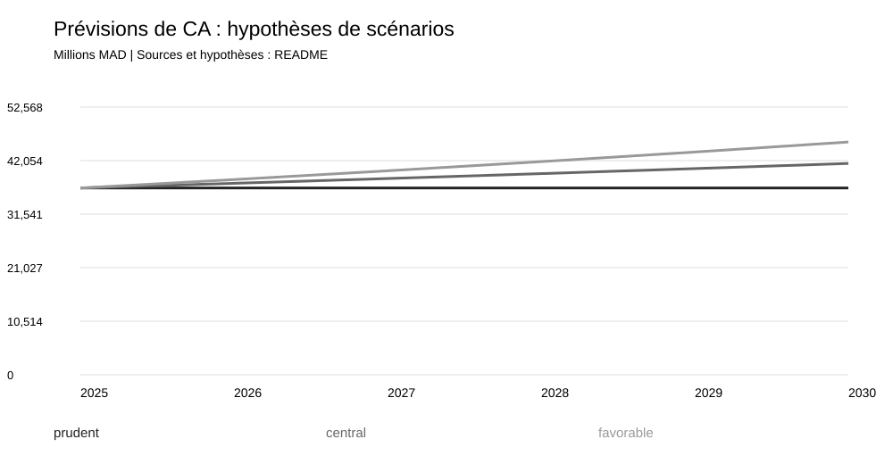

# Maroc Telecom | Financial Analysis & Data Analytics

Reproducible analysis for 2023–2025, with **illustrative 2026–2030 scenarios** and an enterprise-value DCF. Python · SQLite · CSV · SVG charts · Jupyter.

[French documentation](README.fr.md) | [Financial report](reports/financial_report.md) | [Data dictionary](docs/data_dictionary.md) | [Sources](data/raw/sources.csv)

## What this project does

- Separates consolidated Group IFRS figures, adjusted operating KPIs and IAM SA standalone CGNC statements.
- Calculates profitability, liquidity, working-capital and cash-flow indicators.
- Builds prudent, central and favorable scenarios, FCFF, DCF enterprise values and sensitivity analysis.
- Produces CSV tables, a SQLite database, SVG charts and local HTML reports.
- Checks provenance, accounting reconciliations, SQL/CSV consistency and model formulas.



The official KPI series shows revenue of MAD 36,786m in 2023 and MAD 36,681m in 2025, while adjusted EBITDA declines from MAD 19,369m to MAD 18,493m. Stable revenue coexists with declining adjusted operating margins. Source: [Maroc Telecom key figures](https://www.iam.ma/en/groupe-maroc-telecom/chiffre-cl%C3%A9s). Source differences, including 2024 revenue, are documented rather than overwritten.

## Run locally

Python 3.10 or newer. The main pipeline and tests use only the standard library; requirements.txt intentionally has no mandatory packages.

```sh
git clone https://github.com/Ahmedpoxt111/maroc-telecom-financial-analytics.git
cd maroc-telecom-financial-analytics
python -m pip install -r requirements.txt
python -m src.pipeline
python -m unittest discover -s tests -v
python scripts/validate_notebook.py
```

Open COMMENCER_ICI.html, LIRE_LES_TABLEAUX.html or dashboards/dashboard.html locally for readable tables. GitHub displays HTML source; download or clone to open the reports. The [notebook](notebooks/financial_analysis.ipynb) also has a saved [HTML version](notebooks/financial_analysis.html). To execute it, install requirements-notebook.txt, then run `python scripts/execute_notebook.py`.

## Forecast assumptions — not management guidance

Inputs in [config/scenarios.csv](config/scenarios.csv) are labeled assumption; projections are labeled forecast. These are retrospective scenarios valued at **31 December 2025**, with FY2025 as the last historical year. They exclude 2026 releases despite data collection on 7 November 2026, and are not current earnings forecasts.

| Annual assumption | Prudent | Central | Favorable |
|---|---:|---:|---:|
| Revenue growth | 0% | 2.5% | 4.5% |
| EBITDA margin | 48% | 51% | 53% |
| D&A / revenue | 19% | 19% | 19% |
| Total CAPEX / revenue | 28% | 26% | 24% |
| Normalized working capital / revenue | 2% | 2% | 2% |
| Normalized tax rate | 35% | 35% | 35% |
| WACC | 11.5% | 10% | 9% |
| Terminal growth | 1% | 2% | 2.5% |

FCFF = EBIT × (1 − tax rate) + D&A − CAPEX − change in working capital. DCF discounts year-end FCFF for 2026–2030 plus a perpetuity. Initial working capital is an assumed normalized ratio, not reported working capital. Tax is a modeling input, not a statutory-rate assertion; WACC is illustrative, not CAPM-calibrated. See [methodology](docs/methodology.md).



## Contents

| Folder | Contents |
|---|---|
| data/raw/ | Published observations, units, scope, source URLs and page references |
| data/processed/, data/tables/ | Ratios, forecasts, sensitivity, reconciliation tables and SQLite |
| src/, run_analysis.py | Calculations and report generation |
| sql/ | Schema and analytical queries executed by the pipeline |
| charts/, reports/ | Charts, analysis and short French PDF report |
| notebooks/ | Notebook and saved results |
| dashboards/, workbook/ | Local HTML, Power BI inputs/project and Excel workbook |
| tests/ | Provenance, accounting and model checks |

## Validation and limitations

Publication preparation reran the pipeline, **15 tests**, 45 standalone-statement reconciliations and notebook structure/syntax validation successfully. This run did not re-execute Jupyter or visually revalidate the supplied PDF, Excel or Power BI artifacts. The Power BI project is an editable draft whose Desktop rendering remains unverified.

Three annual observations do not establish forecasting validity. Adjusted KPIs are distinct from IFRS figures; published earnings include exceptional effects. Closing-equity ROE, broad working-capital and cash-flow proxies have documented limits. The DCF stops at consolidated **enterprise value**: minority interests and IFRS 16 require reconciliation before an equity bridge or price per share. No target price or investment recommendation is provided.

Independent educational portfolio project; not affiliated with Maroc Telecom and not an audit opinion. Code/documentation: [MIT](LICENSE). Third-party publications and marks retain their rights; official PDFs are linked rather than redistributed.
